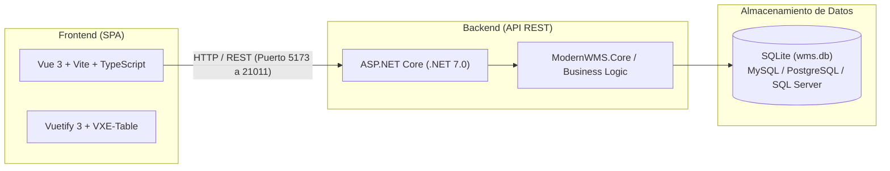

# WMS - Sistema de Gestión de Almacenes

<div align="center">
  
  <h1>WMS</h1>
  <p><strong>Sistema de Gestión de Almacenes (WMS) ágil, moderno y de código abierto</strong></p>
  <p><em>Optimizado para la gestión logística, control de inventario y despacho de mercancías.</em></p>

<!-- Badges -->
[](https://opensource.org/license/apache-2-0/)


[](https://www.sqlite.org/)
[](https://www.mysql.com/downloads/)
[](https://www.microsoft.com/sql-server)
[](https://www.postgresql.org/)


</div>

<div align="center">
  <p>
    <strong>Idiomas / Languages:</strong>
    <strong>Español (Principal)</strong> |
    <a href="README.en.md">English</a> |
    <a href="README.zh_CN.md">中文文档</a>
  </p>
</div>

---

## Índice

- [Introducción](#introducción)
- [Características Principales](#características-principales)
- [Arquitectura del Sistema](#arquitectura-del-sistema)
- [Requisitos Previos](#requisitos-previos)
- [Inicio Rápido (Desarrollo Local)](#inicio-rápido-desarrollo-local)
  - [Opción 1: Lanzador Automático (Recomendado)](#opción-1-lanzador-automático-recomendado)
  - [Opción 2: Inicio Manual](#opción-2-inicio-manual)
- [Credenciales de Acceso](#credenciales-de-acceso)
- [Estructura del Proyecto](#estructura-del-proyecto)
- [Despliegue en Producción](#despliegue-en-producción)
  - [Compilación y Despliegue en Linux con Nginx](#compilación-y-despliegue-en-linux-con-nginx)
  - [Despliegue en Windows](#despliegue-en-windows)
  - [Despliegue con Docker](#despliegue-con-docker)
- [Configuración de Base de Datos](#configuración-de-base-de-datos)
- [Licencia y Créditos](#licencia-y-créditos)

---

## Introducción

**WMS** es una solución integral para la administración, trazabilidad y control de inventarios en depósitos y centros de distribución. Diseñado para ofrecer una experiencia fluida, rápida y adaptable a las necesidades operativas reales de pequeñas, medianas y grandes empresas.

Basado en el motor de código abierto **ModernWMS**, incorpora mejoras en interfaz gráfica, esquemas de estilos temáticos dinámicos, soporte multiidioma y flujos de automatización local listos para usar en entornos Windows y Linux.

---

## Características Principales

- **Gestión de Stock en Tiempo Real:** Control exhaustivo de existencias por almacén, pasillo, estante y ubicación física.
- **Entrada y Recepción (Inbound):** Órdenes de compra, recepción de mercancías, control de calidad y asignación de ubicaciones de almacenamiento.
- **Salida y Despacho (Outbound):** Procesamiento de pedidos de venta, picking, packing, etiquetado y expedición.
- **Trazabilidad y Escaneo:** Compatible con lectores de códigos de barras convencionales y generación/escaneo de códigos QR.
- **Movimientos Internos y Ajustes:** Reubicación de stock, transferencias entre depósitos, inventarios cíclicos y ajustes de mermas.
- **Múltiples Motores de Datos:** Listo para funcionar con SQLite local sin configuraciones complejas, con compatibilidad probada para MySQL, PostgreSQL y SQL Server.
- **Interfaz Moderna y Reactiva:** Diseñada en Vue 3 con Vuetify y VXE-Table para una carga ultrarrápida de grandes volúmenes de datos.

---

## Arquitectura del Sistema



---

## Requisitos Previos

### Entorno Windows
- **Sistema Operativo:** Windows 10 (1607+) o Windows 11 / Windows Server 2012+.
- **.NET SDK:** Versión 7.0 o superior ([Descargar .NET SDK](https://dotnet.microsoft.com/download/dotnet/7.0)).
- **Node.js:** Versión 16.x o superior ([Descargar Node.js](https://nodejs.org/)).
- **Gestor de Paquetes:** npm o Yarn (`npm install -g yarn`).

### Entorno Linux
- Ubuntu 18.04/20.04/22.04 LTS, Debian 10/11, CentOS 8/9 o RHEL 8/9.
- .NET 7.0 SDK y Node.js 16+.

---

## Inicio Rápido (Desarrollo Local)

### Opción 1: Lanzador Automático (Recomendado en Windows)

El repositorio incluye un lanzador automatizado por lotes que levanta el Backend y el Frontend en paralelo en consolas independientes:

1. Haz doble clic en el archivo `start-all.bat` ubicado en la raíz del proyecto.
2. O ejecútalo desde una terminal:
   ```cmd
   .\start-all.bat
   ```
3. El lanzador abrirá:
   - **Backend:** `http://localhost:21011/`
   - **Frontend:** `http://localhost:5173/`

### Opción 2: Inicio Manual

#### 1. Iniciar el Backend (.NET 7.0)
Abre una terminal PowerShell o CMD:
```powershell
cd "backend\ModernWMS"
dotnet run --urls http://0.0.0.0:21011
```
> El servicio quedará activo a la escucha en el puerto `21011`.

#### 2. Iniciar el Frontend (Vue 3 + Vite)
En otra terminal:
```powershell
cd "frontend"
npm install
npm run dev -- --host 0.0.0.0
```
> La aplicación web quedará accesible en `http://localhost:5173/`.

---

## Credenciales de Acceso

Una vez levantados los servicios, ingresa desde tu navegador a:  
👉 **`http://localhost:5173`** (o a la IP de tu servidor)

| Campo | Valor por Defecto |
| :--- | :--- |
| **Usuario** | `admin` |
| **Contraseña** | `1` |

> [!TIP]
> Recuerda cambiar la contraseña del usuario administrador desde el panel de configuración una vez que ingreses al sistema.

---

## Estructura del Proyecto

```text
WMS/
├── backend/                  # Código fuente del Backend (.NET 7.0)
│   ├── ModernWMS/            # API Web, controladores, Startup y appsettings.json
│   │   └── wms.db            # Base de datos SQLite local preconfigurada
│   ├── ModernWMS.Core/       # Entidades centrales, DTOs y utilidades del sistema
│   └── ModernWMS.WMS/        # Lógica de negocio de inventario, stock y logística
├── frontend/                 # Código fuente del Frontend (Vue 3 + TypeScript + Vite)
│   ├── src/                  # Componentes, vistas, rutas y almacén Vuex
│   ├── dist/                 # Artefactos compilados listos para producción
│   └── package.json          # Dependencias y scripts del frontend
├── docker/                   # Archivos para construcción de contenedor Docker y Nginx
├── start-all.bat             # Script de inicio simultáneo para Windows
├── start-backend.ps1         # Script para iniciar backend de forma aislada
├── start-frontend.ps1        # Script para iniciar frontend de forma aislada
├── README.md                 # Documentación principal en Español
├── README.en.md              # Documentación en Inglés
└── README.zh_CN.md           # Documentación original en Chino
```

---

## Despliegue en Producción

### Compilación y Despliegue en Linux con Nginx

1. **Instalar paquetes base:**
   ```bash
   wget https://packages.microsoft.com/config/ubuntu/20.04/packages-microsoft-prod.deb -O packages-microsoft-prod.deb
   sudo dpkg -i packages-microsoft-prod.deb
   sudo apt-get update && sudo apt-get install -y dotnet-sdk-7.0 nodejs gcc g++ make nginx
   sudo npm install -g yarn
   ```

2. **Compilar Frontend:**
   ```bash
   cd frontend
   # Reemplazar la URL base por la IP o dominio de tu servidor
   sed -i 's#http://127.0.0.1#http://<IP_O_DOMINIO>#g' ./.env.production
   yarn && yarn build
   sudo cp -rf dist/* /var/www/html/
   ```

3. **Compilar y Publicar Backend:**
   ```bash
   cd ../backend
   dotnet publish -c Release
   mkdir -p /opt/wms/backend
   cp -rf ModernWMS/bin/Release/net7.0/publish/* /opt/wms/backend/
   cp -rf ModernWMS/wms.db /opt/wms/backend/
   ```

4. **Ejecutar Backend:**
   ```bash
   cd /opt/wms/backend/
   dotnet ModernWMS.dll --urls http://0.0.0.0:21011
   ```

---

### Despliegue en Windows

1. Compila el backend:
   ```cmd
   cd backend
   dotnet publish -c Release -o C:\WMS\backend
   ```
2. Compila el frontend:
   ```cmd
   cd frontend
   yarn build
   ```
3. Aloja la carpeta `dist/` resultante en IIS o Nginx para Windows y configura el backend como servicio de Windows o ejecutable de fondo.

---

### Despliegue con Docker

El directorio `docker/` contiene las definiciones necesarias para empaquetar tanto el backend como el frontend en un único contenedor orquestado:

```bash
cd docker
docker build -t wms:1.0 .
docker run -d -p 21011:21011 -p 80:80 --name wms wms:1.0 ./run.sh
```

---

## Configuración de Base de Datos

Por defecto, el sistema viene configurado para usar **SQLite** con el archivo `backend/ModernWMS/wms.db`. Si deseas cambiar el motor a MySQL, PostgreSQL o SQL Server, edita el archivo `backend/ModernWMS/appsettings.json`:

```json
{
  "Database": { 
    "db": "SqlLite" // Opciones: "SqlLite", "MySql", "SqlServer", "PostGres"
  },
  "ConnectionStrings": {
    "SqlLiteConn": "Data Source = wms.db",
    "MySqlConn": "Server=127.0.0.1;Database=wms;Port=3306;charset=utf8;uid=root;pwd=TU_CONTRASEÑA;",
    "SqlServerConn": "Data Source=127.0.0.1;Connect Timeout=600;User ID=sa;Password=TU_CONTRASEÑA;Initial Catalog=wms;Encrypt=False;",
    "PostGresConn": "Server=127.0.0.1;Port=5432;User Id=postgres;Password=TU_CONTRASEÑA;Database=wms;"
  }
}
```

---

## Licencia y Créditos

Este proyecto se distribuye bajo la licencia **[Apache 2.0](https://opensource.org/license/apache-2-0/) / [MIT](https://opensource.org/licenses/MIT/)**.  
Basado en el software libre original [ModernWMS](https://github.com/fjykTec/ModernWMS).

---

<div align="center">
  <p>WMS © 2026 - Desarrollado y optimizado para la gestión logística eficiente.</p>
</div>
